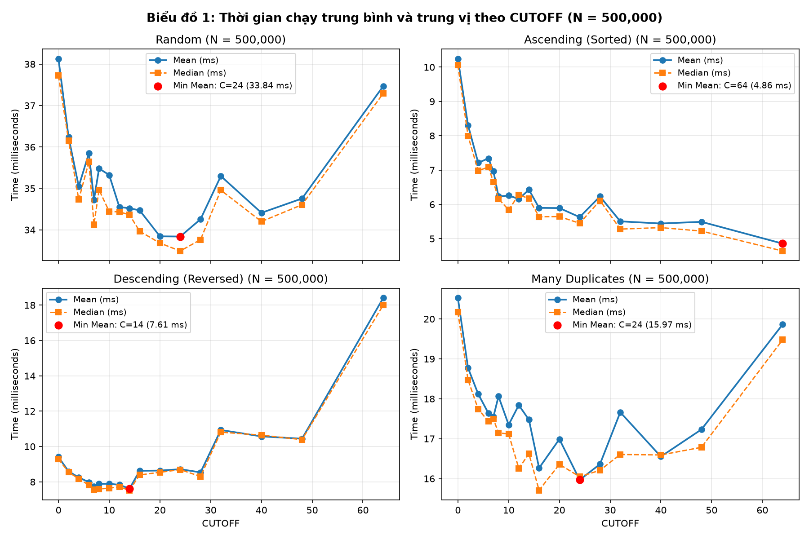
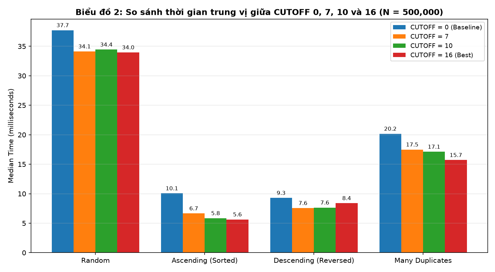
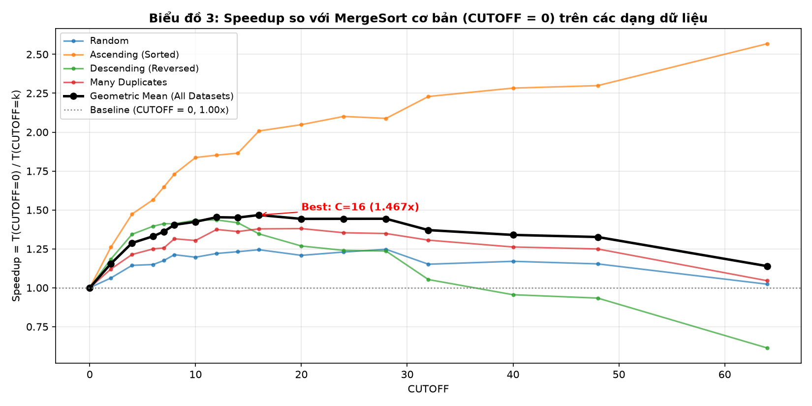
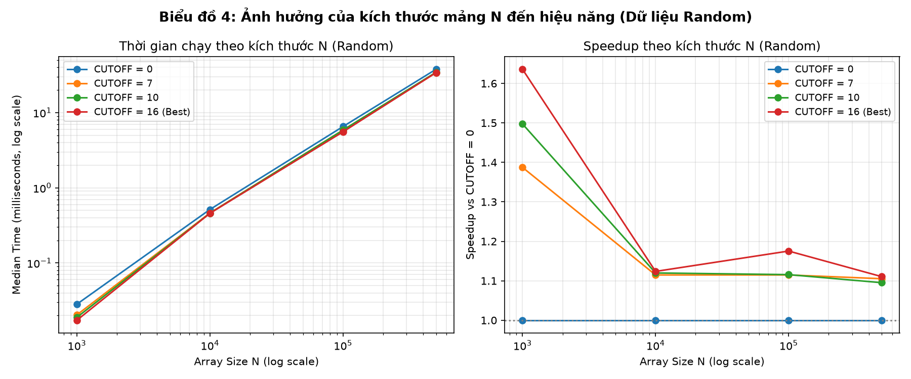
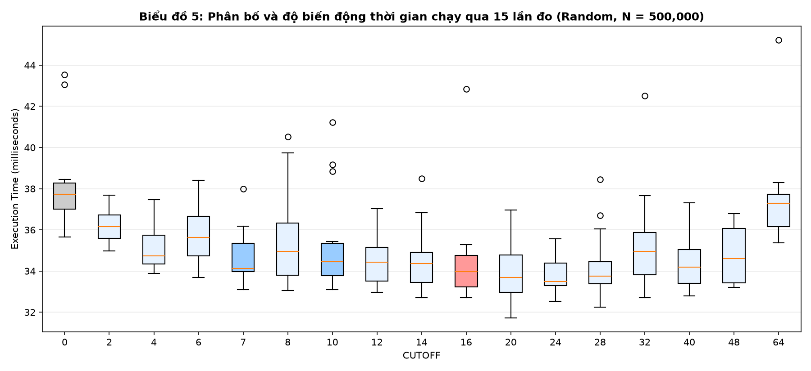

# MergeSort CUTOFF — Experimental Benchmark & Analysis


Nghiên cứu thực nghiệm tìm giá trị **`CUTOFF`** tối ưu (ngưỡng chuyển sang **Insertion Sort** cho mảng con nhỏ) trong thuật toán **MergeSort**, dựa trên giáo trình *Algorithms, 4th Edition* (`Tuan 5 Merge Sort.pdf`, trang 7, 8, 18, 22), đồng thời kiểm chứng hai mốc kinh điển `CUTOFF = 7` và `CUTOFF = 10`.

---

## 1. Thiết kế & Môi trường thí nghiệm

### Cấu hình máy thực nghiệm (`results/machine.txt`)
- **Hệ điều hành:** Microsoft Windows 11 Pro 10.0.26300 (64-bit)
- **CPU:** Intel(R) Core(TM) Ultra 9 185H (16 cores, 22 logical processors, 2500 MHz)
- **RAM:** 31.41 GB
- **Compiler & Flags:** `g++.exe` 15.2.0 (MinGW-W64 i686-ucrt-posix-dwarf) với `-std=c++17 -O2 -DNDEBUG`
- **Python:** 3.12.10 (`matplotlib` 3.11.2, `pandas` 3.1.1, `numpy` 2.5.5)

### Phương pháp đo
- **17 giá trị CUTOFF:** `0, 2, 4, 6, 7, 8, 10, 12, 14, 16, 20, 24, 28, 32, 40, 48, 64` (với `CUTOFF = 0` là MergeSort thuần túy làm baseline).
- **4 kích thước mảng ($N$):** `1,000`, `10,000`, `100,000`, `500,000`.
- **4 phân bố dữ liệu (seed cố định `20261117 + n`):** `random`, `ascending` (tăng dần), `descending` (giảm dần), `duplicates` (16 giá trị lặp).
- **Quy trình kiểm soát nhiễu:** Chạy warm-up toàn bộ 17 mức trước khi đo; lặp **15 lần** mỗi cấu hình (tổng cộng **4,080 lượt đo thô**); xáo trộn ngẫu nhiên thứ tự thử CUTOFF ở mỗi vòng; copy mảng gốc ngoài vùng đo `chrono::steady_clock`; kiểm tra `std::is_sorted` sau mỗi lần chạy.

---

## 2. Kết quả thực nghiệm

### Bảng xếp hạng tổng thể (Geometric Mean Speedup trên 16 bộ dữ liệu)

| Hạng | CUTOFF | Geometric Mean Speedup (Median) | Geometric Mean Speedup (Mean) | Mean Normalized Median | CV trung bình (%) |
|---:|---:|---:|---:|---:|---:|
| **1** | **16** | **1.4674x** | 1.4486x | 0.6985 | 14.41% |
| 2 | 12 | 1.4534x | **1.4551x** | 0.7014 | 11.41% |
| 3 | 14 | 1.4511x | 1.4444x | 0.7024 | 12.09% |
| 4 | 28 | 1.4435x | 1.4417x | 0.7137 | 12.79% |
| 5 | 24 | 1.4432x | 1.4226x | 0.7137 | 15.47% |
| 6 | 20 | 1.4428x | 1.4393x | 0.7128 | 13.32% |
| **7** | **10** | **1.4239x** | 1.4141x | 0.7153 | 13.28% |
| 8 | 8 | 1.4046x | 1.3983x | 0.7248 | 11.35% |
| 9 | 32 | 1.3706x | 1.2009x | 0.7626 | 41.62% |
| **10** | **7** | **1.3609x** | 1.3567x | 0.7434 | 11.75% |
| 17 | 0 (Baseline) | 1.0000x | 1.0000x | 1.0000 | 10.87% |

### So sánh tại kích thước lớn nhất ($N = 500,000$)

| Dạng dữ liệu | CUTOFF = 0 (ms) | CUTOFF = 7 (ms) | CUTOFF = 10 (ms) | CUTOFF = 16 (ms) | Speedup (16 vs 0) |
|---|---:|---:|---:|---:|---:|
| `ascending` | 10.061 | 6.661 | 5.842 | **5.639** | **1.784x** |
| `descending` | 9.285 | **7.566** | 7.645 | 8.391 | 1.107x |
| `duplicates` | 20.169 | 17.489 | 17.115 | **15.707** | **1.284x** |
| `random` | 37.721 | 34.129 | 34.443 | **33.966** | **1.111x** |

*(Giá trị trong bảng trên là thời gian trung vị `median_ms` qua 15 lần đo.)*

### Kết luận chính
- **Vùng CUTOFF tối ưu:** **`12–16`** trên máy thử nghiệm này; trong đó **`CUTOFF = 16`** đạt hiệu năng tổng hợp cao nhất (**1.467x**), còn **`CUTOFF = 12`** rất sát (**1.453x**) nhưng ổn định hơn (CV **11.41%**) và giữ hiệu năng tốt trên dữ liệu giảm dần (`descending`).
- **So sánh CUTOFF 7 và 10:** Tổng thể **`CUTOFF = 10`** (**1.424x**) nhanh hơn **`CUTOFF = 7`** (**1.361x**) khoảng **4.6%**, nhưng trên mảng lớn ngẫu nhiên/giảm dần ($N = 500,000$), chênh lệch nhỏ hơn độ biến động đo thực tế.

---

## 3. Biểu đồ trực quan

### Biểu đồ 1: Thời gian chạy trung bình và trung vị theo CUTOFF ($N = 500,000$)


### Biểu đồ 2: So sánh CUTOFF 0, 7, 10 và 16 ($N = 500,000$)


### Biểu đồ 3: Speedup so với MergeSort cơ bản (CUTOFF = 0)


### Biểu đồ 4: Ảnh hưởng của kích thước mảng $N$ (Dữ liệu Random)


### Biểu đồ 5: Phân bố và độ biến động thời gian chạy (Random, $N = 500,000$)


---

## 4. Cấu trúc thư mục

- `src/mergesort_user.cpp`: Cài đặt MergeSort + CUTOFF của sinh viên.
- `src/benchmark.cpp`: Chương trình benchmark C++ (warm-up, xáo trộn CUTOFF, `steady_clock`).
- `src/test.cpp`: Chương trình kiểm thử đơn giản qua stdin/stdout.
- `scripts/generate_data.py`: Sinh 16 bộ dữ liệu với seed cố định.
- `scripts/run_experiments.py`: Tự động chạy benchmark và gom kết quả vào `results/all_runs.csv`.
- `scripts/analyze.py` & `scripts/full_analysis.py`: Thống kê chi tiết và xuất 5 biểu đồ báo cáo.
- `results/`: `machine.txt`, `all_runs.csv`, `summary.csv`, `detailed_summary.csv`, `ranking.csv`, `detailed_ranking.csv` và `results/charts/*.png`.
- `report/report.md`: Báo cáo thí nghiệm hoàn chỉnh bằng tiếng Việt.
- `docs/ai_chat_log.md` & `chatlog/AI_USAGE.md`: Nhật ký sử dụng AI.

---

## 5. Hướng dẫn tái lập thí nghiệm (Windows PowerShell)

### 5.1. Cài đặt thư viện Python
```powershell
python -m pip install -r requirements.txt
```

### 5.2. Biên dịch chương trình C++ (Release `-O2`)
```powershell
g++ -std=c++17 -O2 -DNDEBUG src/benchmark.cpp src/mergesort_user.cpp -o benchmark.exe
```

### 5.3. Sinh bộ dữ liệu thí nghiệm
```powershell
python scripts/generate_data.py
```

### 5.4. Chạy benchmark (15 lần lặp mỗi cấu hình + warm-up)
```powershell
python scripts/run_experiments.py --exe ./benchmark.exe --trials 15
```

### 5.5. Phân tích thống kê và vẽ biểu đồ
```powershell
python scripts/analyze.py
python scripts/full_analysis.py
```
