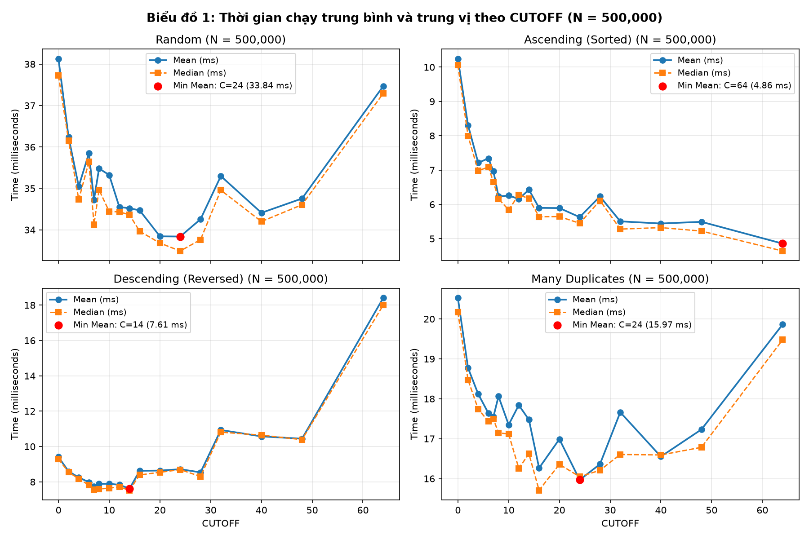
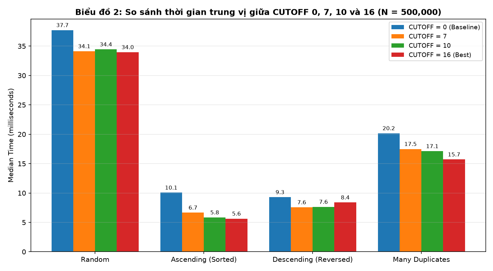
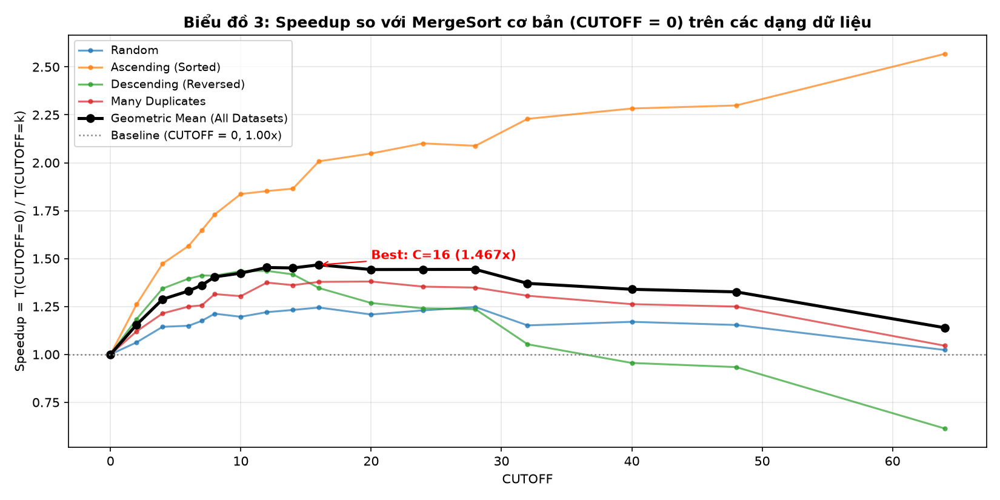
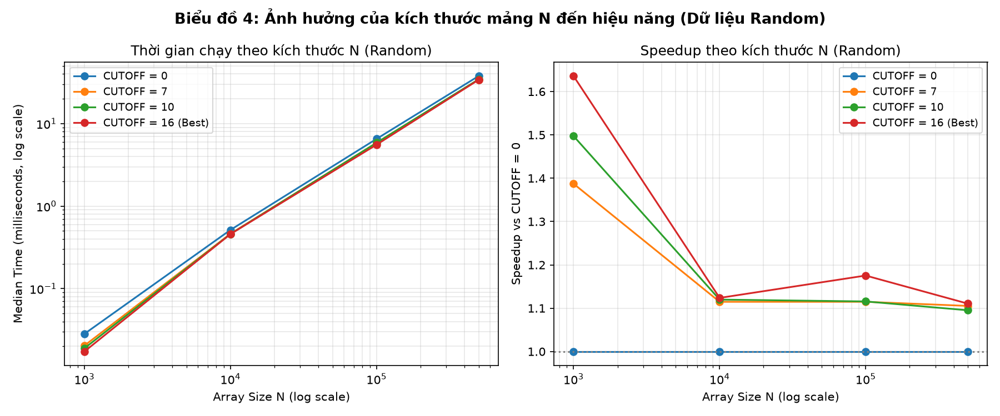
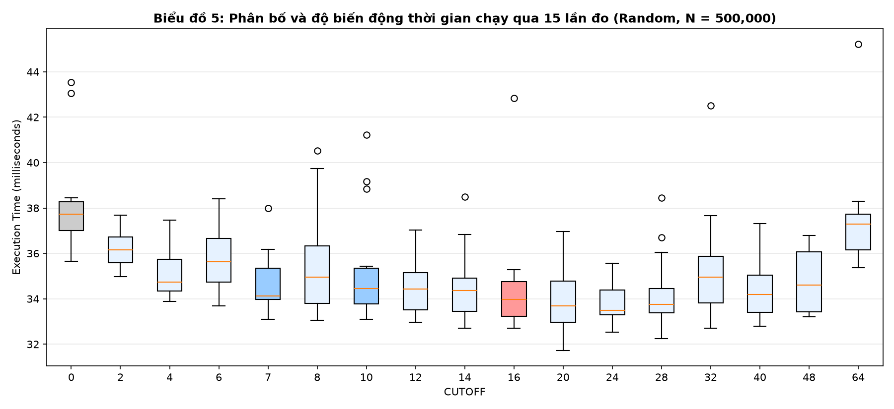

# Báo cáo thực nghiệm: Tìm giá trị CUTOFF tối ưu cho MergeSort

**Họ và tên:** Vũ Đức Trung  
**Mã sinh viên:** 25022036  
**Học phần:** 2627I_UET.CS1058_9  
**Tài liệu tham khảo:** `Tuan 5 Merge Sort.pdf` (Robert Sedgewick & Kevin Wayne, *Algorithms, 4th Edition* — Lecture 2.2 Mergesort)

---

## 1. Giới thiệu

**MergeSort** là thuật toán sắp xếp chia để trị (divide-and-conquer) kinh điển với độ phức tạp đảm bảo $O(N \log N)$ trong mọi trường hợp và có tính ổn định (stable) (Slide 4, 35, 55). Tuy nhiên, trong thực tế cài đặt, MergeSort thuần túy phải thực hiện nhiều lời gọi đệ quy và thao tác sao chép/trộn trên các mảng con rất nhỏ, tạo ra chi phí phụ (overhead) đáng kể (Slide 18).

**Insertion Sort** tuy có độ phức tạp trung bình và xấu nhất là $O(N^2)$ (Slide 57), nhưng lại có hằng số ẩn rất nhỏ, ít chi phí quản lý đệ quy, hoạt động tại chỗ (in-place) và tận dụng tốt bộ nhớ đệm (CPU cache) cũng như thứ tự có sẵn trong dữ liệu.

**CUTOFF** là ngưỡng kích thước mảng con mà tại đó MergeSort ngừng chia nhỏ đệ quy và chuyển sang dùng Insertion Sort để sắp xếp trực tiếp đoạn mảng con `a[l..r]` (Slide 18). Trong giáo trình *Algorithms* của Sedgewick & Wayne, các phiên bản khác nhau đề cập đến các giá trị CUTOFF kinh điển như `CUTOFF = 7` (Java 6 `Arrays.sort`, Slide 22) và `CUTOFF ≈ 10` (Slide 18).

Vì hiệu năng thực tế phụ thuộc vào kiến trúc CPU, hệ thống bộ nhớ đệm, trình biên dịch, cờ tối ưu hóa và cách cài đặt cụ thể, ta cần tiến hành **đo đạc thực nghiệm** trên chính máy tính cá nhân để xác định giá trị CUTOFF phù hợp nhất, đồng thời kiểm chứng hai mốc `7` và `10` trong giáo trình.

---

## 2. Cơ sở lý thuyết

- **MergeSort ($O(N \log N)$):** Chia mảng thành hai nửa, đệ quy sắp xếp từng nửa rồi trộn lại (Slide 4, 7–8). Với mảng độ dài $N$, số phép so sánh tối đa là $N \lg N$ (Slide 13–15) và số lần truy cập mảng tối đa là $6 N \lg N$ (Slide 16). Nhược điểm là cần thêm mảng phụ `aux[]` kích thước $N$ (Slide 17) và chi phí gọi hàm đệ quy lớn khi mảng con chỉ còn vài phần tử.
- **Insertion Sort ($O(N^2)$):** Ở mỗi bước $i$, chèn phần tử `a[i]` vào đúng vị trí trong đoạn đã sắp xếp phía trước (Slide 52). Trong trường hợp tốt nhất (mảng đã tăng dần) chỉ tốn $N-1$ phép so sánh ($\approx N$); trường hợp trung bình tốn $\approx \frac{1}{4}N^2$ và trường hợp xấu nhất (mảng giảm dần) tốn $\approx \frac{1}{2}N^2$ phép so sánh và hoán đổi (Slide 57).
- **Lợi ích khi kết hợp CUTOFF:** Khi kích thước mảng con $k = r - l + 1 \le \text{CUTOFF}$ nhỏ, đại lượng $\frac{1}{4}k^2$ rất bé và chi phí vòng lặp đơn giản của Insertion Sort nhỏ hơn đáng kể so với chi phí gọi đệ quy + sao chép mảng phụ `mer` của MergeSort (Slide 18).
- **Cách kết hợp trong mã nguồn thực nghiệm ([src/mergesort_user.cpp](file:///c:/Users/vdt05/OneDrive/All%20C++%20VSC/C++%20VSC/2026/Nov%2017%202026/Mergesort%20Cutoff/src/mergesort_user.cpp)):**
  - Hàm `sort_rec` kiểm tra điều kiện `if (cutoff > 0 && r - l + 1 <= cutoff)` thì gọi `insertion_sort(a, l, r)` rồi `return`.
  - Khi `cutoff == 0`, thuật toán chạy MergeSort thuần túy (base case `l >= r`).
  - Thí nghiệm cố ý **không** bật các tối ưu khác ở Slide 20 (*stop if already sorted*) và Slide 21 (*switch roles of aux[] and a[]*) để cô lập hoàn toàn ảnh hưởng của tham số CUTOFF.

---

## 3. Môi trường thí nghiệm

Cấu hình phần cứng và phần mềm thực tế được ghi nhận trong [results/machine.txt](../results/machine.txt):

| Thành phần | Thông số thực tế |
|---|---|
| **Hệ điều hành** | Microsoft Windows 11 Pro 10.0.26300 (64-bit) |
| **CPU** | Intel(R) Core(TM) Ultra 9 185H (16 cores, 22 logical processors, 2500 MHz) |
| **RAM** | 31.41 GB |
| **Trình biên dịch C++** | `g++.exe` 15.2.0 (MinGW-W64 i686-ucrt-posix-dwarf, Brecht Sanders r4) |
| **Cờ biên dịch (Release)** | `-std=c++17 -O2 -DNDEBUG` |
| **Python & Thư viện** | Python 3.12.10 (`matplotlib` 3.11.2, `pandas` 3.1.1, `numpy` 2.5.5) |

---

## 4. Phương pháp thí nghiệm

### 4.1. Kiểm tra tính đúng đắn trước khi benchmark
Trước khi đo thời gian, hàm `merge_sort` được kiểm thử với cờ `-D_GLIBCXX_DEBUG` đối chiếu với `std::sort` trên các trường hợp: mảng rỗng, mảng 1 phần tử, tăng dần, giảm dần, chứa số âm, nhiều phần tử trùng nhau, kích thước lẻ (`N = 15`), và mảng ngẫu nhiên (`N = 1001`) với các giá trị `CUTOFF = 0, 7, 10, 32`. Tất cả các ca kiểm thử đều vượt qua (`ALL_TESTS_PASSED`).

*(Ghi chú: Trong quá trình kiểm thử ban đầu, `-D_GLIBCXX_DEBUG` phát hiện lỗi biên `j >= l` gây truy cập `a[-1]` ở `insertion_sort` và xung đột `int main()` khi link với `benchmark.cpp`; cả hai đã được sửa thành `j > l` và bỏ `main()` khỏi `mergesort_user.cpp` trước khi chạy thí nghiệm chính thức.)*

### 4.2. Thiết kế thực nghiệm
- **Các giá trị CUTOFF (17 mức):** `0, 2, 4, 6, 7, 8, 10, 12, 14, 16, 20, 24, 28, 32, 40, 48, 64`.
- **Kích thước mảng ($N$):** `1,000`, `10,000`, `100,000`, `500,000`.
- **Phân bố dữ liệu (4 dạng, sinh bằng `scripts/generate_data.py` với seed cố định `20261117 + n`):**
  - `random`: số nguyên ngẫu nhiên trong `[-1000000, 1000000]`.
  - `ascending`: mảng đã sắp xếp tăng dần.
  - `descending`: mảng sắp xếp giảm dần hoàn toàn.
  - `duplicates`: mảng chỉ gồm 16 giá trị phân biệt (`0..15`).
- **Kiểm soát sai lệch trong `src/benchmark.cpp`:**
  - Chạy **warm-up** qua toàn bộ 17 giá trị CUTOFF trước khi đo chính thức.
  - Mỗi bộ dữ liệu đo **15 lần lặp** (`trials = 15`), tổng cộng $16 \times 17 \times 15 = 4,080$ lượt đo thô.
  - Trong mỗi lần lặp, **xáo trộn ngẫu nhiên thứ tự thử CUTOFF** (`std::shuffle` với `mt19937`) để tránh thiên lệch do nhiệt độ CPU hay trạng thái cache.
  - Mỗi lượt đo đều sao chép lại mảng gốc `orig` **ngoài vùng đo thời gian** (`chrono::steady_clock`), không tính thời gian đọc file.
  - Kiểm tra `std::is_sorted` sau mỗi lần sắp xếp.
- **Phương pháp thống kê:** Tính `mean`, `median`, `stdev`, `min`, `max`, hệ số biến thiên `CV (%) = stdev / mean * 100%`, và `Speedup = T_median(CUTOFF=0) / T_median(CUTOFF=k)`. Xếp hạng tổng thể sử dụng **trung bình nhân (geometric mean)** của `Speedup` trên toàn bộ 16 bộ dữ liệu.

---

## 5. Kết quả thực nghiệm

### 5.1. Bảng xếp hạng tổng thể CUTOFF (16 bộ dữ liệu, 4,080 lượt đo)

| Hạng | CUTOFF | Geometric Mean Speedup (Median) | Geometric Mean Speedup (Mean) | Mean Normalized Median | CV trung bình (%) |
|---:|---:|---:|---:|---:|---:|
| **1** | **16** | **1.4674x** | 1.4486x | 0.6985 | 14.41% |
| 2 | 12 | 1.4534x | **1.4551x** | 0.7014 | 11.41% |
| 3 | 14 | 1.4511x | 1.4444x | 0.7024 | 12.09% |
| 4 | 28 | 1.4435x | 1.4417x | 0.7137 | 12.79% |
| 5 | 24 | 1.4432x | 1.4226x | 0.7137 | 15.47% |
| 6 | 20 | 1.4428x | 1.4393x | 0.7128 | 13.32% |
| **7** | **10** | **1.4239x** | 1.4141x | 0.7153 | 13.28% |
| 8 | 8 | 1.4046x | 1.3983x | 0.7248 | 11.35% |
| 9 | 32 | 1.3706x | 1.2009x | 0.7626 | 41.62% |
| **10** | **7** | **1.3609x** | 1.3567x | 0.7434 | 11.75% |
| 17 | 0 (Baseline) | 1.0000x | 1.0000x | 1.0000 | 10.87% |

*(Chi tiết đầy đủ cho cả 17 mức CUTOFF xem tại [results/detailed_ranking.csv](../results/detailed_ranking.csv) và [results/detailed_summary.csv](../results/detailed_summary.csv).)*

### 5.2. Kết quả chi tiết tại kích thước lớn nhất ($N = 500,000$)

| Dạng dữ liệu | CUTOFF | Mean (ms) | Median (ms) | Stdev (ms) | Min (ms) | Max (ms) | Speedup (Median) |
|---|---:|---:|---:|---:|---:|---:|---:|
| `ascending` | 0 | 10.246 | 10.061 | 0.949 | 8.957 | 12.754 | 1.000x |
| `ascending` | 7 | 6.970 | 6.661 | 1.093 | 5.892 | 9.932 | 1.510x |
| `ascending` | 10 | 6.257 | 5.842 | 0.946 | 5.484 | 8.953 | 1.722x |
| `ascending` | **16** | **5.899** | **5.639** | 1.008 | 5.075 | 8.981 | **1.784x** |
| `descending` | 0 | 9.405 | 9.285 | 0.536 | 8.672 | 10.418 | 1.000x |
| `descending` | **7** | **7.737** | **7.566** | 0.568 | 7.221 | 9.457 | **1.227x** |
| `descending` | 10 | 7.892 | 7.645 | 0.810 | 7.157 | 9.604 | 1.214x |
| `descending` | 16 | 8.626 | 8.391 | 0.759 | 7.955 | 10.367 | 1.107x |
| `duplicates` | 0 | 20.525 | 20.169 | 1.321 | 19.113 | 24.174 | 1.000x |
| `duplicates` | 7 | 17.546 | 17.489 | 1.009 | 16.338 | 19.643 | 1.153x |
| `duplicates` | 10 | 17.348 | 17.115 | 0.794 | 16.015 | 19.176 | 1.178x |
| `duplicates` | **16** | **16.265** | **15.707** | 1.398 | 15.047 | 19.253 | **1.284x** |
| `random` | 0 | 38.131 | 37.721 | 2.243 | 35.655 | 43.547 | 1.000x |
| `random` | 7 | 34.727 | 34.129 | 1.235 | 33.105 | 37.993 | 1.105x |
| `random` | 10 | 35.324 | 34.443 | 2.424 | 33.105 | 41.217 | 1.095x |
| `random` | **16** | **34.470** | **33.966** | 2.459 | 32.707 | 42.835 | **1.111x** |

### 5.3. CUTOFF tốt nhất theo từng kích thước và dạng dữ liệu

- **Theo kích thước mảng (trung bình nhân trên 4 dạng dữ liệu):**
  - $N = 1,000$: **CUTOFF = 16** (`1.770x`), vượt `10` (`1.654x`) và `7` (`1.511x`).
  - $N = 10,000$: **CUTOFF = 12** (`1.456x`), sát nút với `10` (`1.448x`), cao hơn `7` (`1.354x`).
  - $N = 100,000$: **CUTOFF = 16** (`1.406x`), cao hơn `7` (`1.353x`) và `10` (`1.340x`).
  - $N = 500,000$: **CUTOFF = 16** (`1.295x`), cao hơn `10` (`1.282x`) và `7` (`1.240x`).
- **Theo dạng dữ liệu (trung bình nhân trên 4 kích thước):**
  - `ascending`: **CUTOFF = 64** (`2.568x`) vì mảng đã sắp xếp nên Insertion Sort chạy tuyến tính $O(k)$ mà không tốn chi phí merge.
  - `descending`: **CUTOFF = 12** (`1.436x`), gần tương đương `10` (`1.435x`) và `7` (`1.412x`).
  - `duplicates`: **CUTOFF = 20** (`1.380x`), cao hơn `10` (`1.304x`) và `7` (`1.256x`).
  - `random`: **CUTOFF = 28** (`1.247x`), cao hơn `10` (`1.196x`) và `7` (`1.175x`).

### 5.4. Biểu đồ trực quan

---

## 6. Phân tích và thảo luận

1. **Xu hướng thời gian chạy theo CUTOFF:** Khi tăng CUTOFF từ `0` lên vùng `12–20`, thời gian chạy giảm rõ rệt nhờ loại bỏ được các tầng đệ quy dưới cùng (chiếm nhiều lời gọi hàm nhất) và giảm số lần sao chép mảng phụ `mer`. Khi tăng CUTOFF quá lớn (`40, 48, 64`), chi phí $O(k^2)$ của Insertion Sort bắt đầu lấn át, khiến hiệu năng giảm dần (riêng `CUTOFF = 64` cho điểm trung vị chuẩn hóa `1.0019`, thậm chí chậm hơn baseline ở một số ca `descending`/`random`).
2. **Ảnh hưởng của kích thước mảng $N$:** Ở $N = 1,000$, speedup đạt tới `1.77x`, trong khi ở $N = 500,000$ speedup giảm xuống còn `1.30x` (và `1.11x` trên dữ liệu `random`). Điều này hợp lý vì khi $N$ lớn, các lần trộn ở tầng trên (kích thước lớn) và truy cập bộ nhớ RAM/L3 cache chiếm tỷ trọng thời gian chủ đạo, làm giảm tỷ lệ đóng góp của việc tối ưu các đoạn lá nhỏ.
3. **Ảnh hưởng của phân bố dữ liệu:**
   - Trên `ascending`, Insertion Sort chỉ duyệt tuyến tính $O(k)$ nên CUTOFF càng lớn càng lợi.
   - Trên `descending`, Insertion Sort rơi vào trường hợp xấu nhất $\frac{1}{2}k^2$ nên CUTOFF lớn (`16` trở lên) bị chậm lại rõ rệt (`8.39 ms` so với `7.57 ms` của `CUTOFF = 7` tại $N=500,000$).
4. **So sánh trực tiếp CUTOFF 7 và 10:**
   - Tổng thể trên 16 bộ dữ liệu, **CUTOFF = 10** (`1.424x`) nhanh hơn **CUTOFF = 7** (`1.361x`) khoảng **4.6%**.
   - Tuy nhiên, tại $N = 500,000$ trên `random` (`34.44 ms` vs `34.13 ms`) và `descending` (`7.65 ms` vs `7.57 ms`), chênh lệch giữa 7 và 10 chỉ khoảng `0.1–0.3 ms`, nhỏ hơn độ lệch chuẩn đo được (`0.57–2.42 ms`). Do đó trên mảng ngẫu nhiên/giảm dần kích thước lớn, hiệu năng của 7 và 10 là **tương đương nhau trong phạm vi sai số thực nghiệm**.
5. **Độ ổn định và giới hạn đo đạc:** Hệ số biến thiên CV trung bình nằm trong khoảng `11%–15%` (riêng `CUTOFF = 32` có một số spike nhiễu nền làm CV tăng lên `41.6%`, nhưng median vẫn ổn định ở `1.371x`). Vì vậy dùng **median** và **geometric mean of speedup** là hợp lý để kháng nhiễu từ tiến trình nền Windows, thay đổi xung nhịp boost của CPU Intel Core Ultra 9 185H và hiệu ứng bộ nhớ đệm.

---

## 7. Kết luận

- **Giá trị CUTOFF khuyến nghị:** Trên cấu hình máy Windows 11 + Intel Core Ultra 9 185H + `g++ 15.2.0 -O2` với cài đặt `mergesort_user.cpp`, vùng tối ưu nằm trong khoảng **`CUTOFF = 12` đến `16`**, trong đó:
  - **`CUTOFF = 16`** đạt hiệu năng tổng hợp cao nhất (`1.467x` geometric mean speedup).
  - **`CUTOFF = 12`** đạt hiệu năng rất sát (`1.453x`, chỉ chênh ~1% — nhỏ hơn độ biến động đo) nhưng **ổn định hơn** (CV `11.41%` so với `14.41%`) và giữ hiệu năng tốt trên dữ liệu giảm dần (`descending`).
- **So sánh với giáo trình:**
  - Kết quả thực nghiệm cho thấy cả **`CUTOFF = 7`** (`1.361x`, Slide 22) và **`CUTOFF = 10`** (`1.424x`, Slide 18) đều cải thiện rõ rệt so với MergeSort thuần túy (`CUTOFF = 0`), và `10` nhỉnh hơn `7` trên phần lớn các bộ dữ liệu.
  - Trên kiến trúc CPU hiện đại với `-O2`, ngưỡng tối ưu thực tế (`12–16`) hơi cao hơn một chút so với mốc `7–10` trong giáo trình Java cũ, do tốc độ xử lý tuần tự trên thanh ghi/L1 cache của CPU hiện đại rất cao so với chi phí gọi đệ quy.
